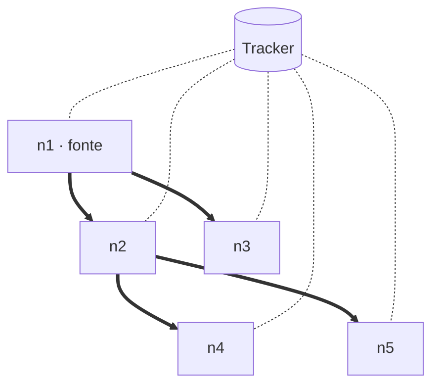
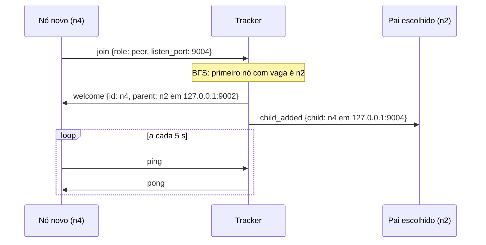
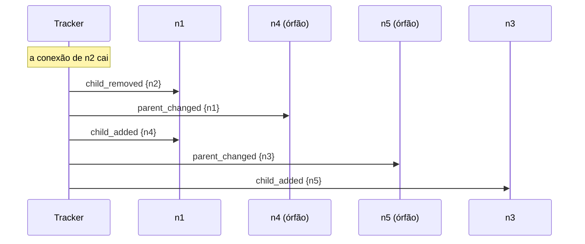
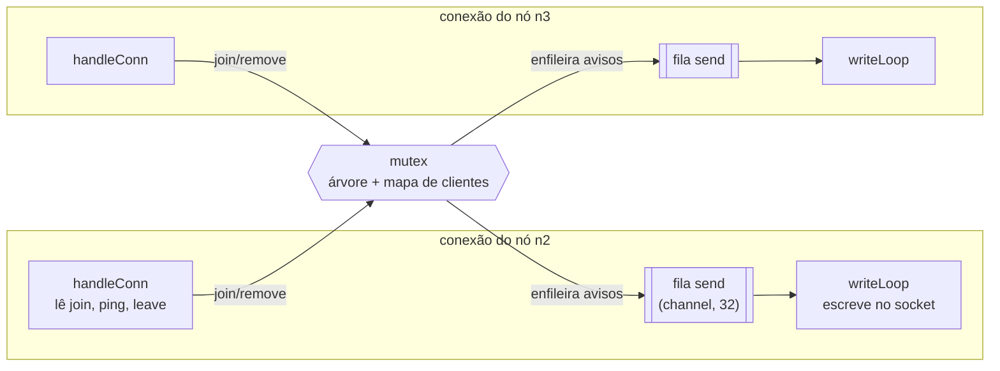

# Arquitetura do tracker

## 1. Papel do tracker no sistema

O sistema tem dois planos:

- **Plano de controle**: quem está na rede e quem recebe de quem. É o trabalho do tracker.
- **Plano de dados**: os segmentos de vídeo, que vão direto de um nó para outro,
  de pai para filho, sem passar pelo tracker. É o trabalho do cliente.



Linha grossa: segmentos de vídeo (plano de dados). Linha tracejada: conexão TCP
de controle com o tracker, que cada nó mantém aberta.

O tracker nunca toca no vídeo. Ele só decide a topologia e avisa os nós; com
isso a carga dele não cresce com a taxa de bits do vídeo, só com o número de nós.

## 2. Decisões de projeto

| Decisão | Escolha | Por quê |
|---|---|---|
| Topologia | árvore com no máximo `fanout` filhos por nó (padrão 2, árvore binária) | Cada nó recebe de um só pai, o que é simples de implementar e de explicar. O `fanout` é uma opção (`-fanout 3`) para comparar no relatório. |
| Onde entra um nó novo | no nó com vaga mais perto da raiz (busca em largura) | Mantém a árvore baixa: com fanout 2, 1000 nós ficam a no máximo 9 saltos da fonte. |
| Transporte | TCP | Entrega garantida e em ordem, e a conexão aberta serve para detectar quando o nó cai. |
| Formato das mensagens | JSON, um objeto por linha | Legível (dá para depurar lendo o log), e o Go codifica e decodifica com a biblioteca padrão. |
| Conexão | persistente: aberta no join e mantida até a saída | O tracker precisa avisar o nó a qualquer momento (filho novo, pai novo), então a conexão não pode ser só pedido/resposta. |
| Identificação | o tracker dá os IDs (`n1`, `n2`, …) | Evita colisão e deixa os logs fáceis de ler. |
| Endereço do nó | o nó informa só a porta; o IP vem da própria conexão TCP | O nó nem sempre sabe o próprio IP na rede (pode ter várias interfaces), mas o tracker vê de onde a conexão veio. |
| Fonte | o nó que entra com `role: source` vira a raiz; só uma por vez | A raiz da árvore é quem tem o vídeo. |
| Concorrência | uma goroutine por conexão, mutex na árvore, fila de envio por nó | Ver seção 6. |

### Árvore ou malha?

Na **malha** (mesh), cada nó troca segmentos com vários vizinhos e pede o que
falta a quem tiver. Ela é mais resistente a falhas (perder um vizinho não corta o
vídeo) e aproveita melhor a banda de upload de todo mundo, mas exige que cada nó
saiba quais segmentos os vizinhos têm (mapas de buffer) e decida de quem pedir
cada um.

Na **árvore**, o caminho de cada segmento é fixo, da fonte até as folhas. É bem
mais simples, mas a queda de um nó interrompe a subárvore inteira até o tracker
religar os órfãos, e as folhas, que são metade dos nós numa árvore binária, não
fazem upload para ninguém.

Escolhemos a árvore pela simplicidade. A malha fica como evolução possível.

## 3. Protocolo

Cada nó abre uma conexão TCP com o tracker (porta 8000 por padrão) e manda
objetos JSON, um por linha. O tracker responde pela mesma conexão. As definições
ficam em [`protocol/protocol.go`](../protocol/protocol.go), que o cliente também
importa.

### Mensagens do nó para o tracker

| type | Campos | Quando |
|---|---|---|
| `join` | `role` (`source` ou `peer`), `listen_port` | Primeira mensagem, obrigatória. `listen_port` é a porta onde o nó aceita conexões dos filhos. |
| `ping` | nenhum | A cada 5 s (heartbeat). |
| `leave` | nenhum | Ao sair de forma voluntária. |

### Mensagens do tracker para o nó

| type | Campos | Significado para o cliente |
|---|---|---|
| `welcome` | `id`, `depth`, `parent` (`id` e `addr`; ausente para a fonte) | Entrou. Conectar no pai para receber o vídeo. |
| `error` | `error` (texto) | Join recusado. O tracker fecha a conexão logo depois. |
| `pong` | nenhum | Resposta ao ping; mostra que o tracker está vivo. |
| `child_added` | `child` (`id` e `addr`) | Ganhou um filho: começar a transmitir para ele. |
| `child_removed` | `child` | Esse filho saiu: parar de transmitir para ele. |
| `parent_changed` | `parent` | O pai saiu: passar a receber do novo pai. |
| `stream_ended` | nenhum | A fonte saiu e a transmissão acabou. O tracker fecha a conexão. |

### Exemplo de sessão

```
-> {"type":"join","role":"peer","listen_port":9004}
<- {"type":"welcome","id":"n4","depth":2,"parent":{"id":"n2","addr":"127.0.0.1:9002"}}
-> {"type":"ping"}
<- {"type":"pong"}
<- {"type":"parent_changed","parent":{"id":"n1","addr":"127.0.0.1:9001"}}
<- {"type":"stream_ended"}
```

### Entrada de um nó



### Motivos de recusa do join

- Um peer tenta entrar sem fonte conectada ("ainda não há fonte").
- Uma segunda fonte tenta entrar ("já existe uma fonte").
- O `role` é inválido, a `listen_port` está fora de 1–65535, ou a primeira mensagem não é `join`.

## 4. Entrada: onde colocar o nó novo

O tracker faz uma **busca em largura (BFS)** a partir da raiz e escolhe o
primeiro nó com menos de `fanout` filhos (`findParent` em
[`tracker/tree.go`](../tracker/tree.go)). Como a BFS anda nível por nível, o nó
escolhido é sempre o mais raso com vaga, e a árvore vai sendo preenchida em
camadas:

```
ordem de entrada: n1 (fonte), n2, n3, n4, n5, n6, n7

          n1                profundidade 0
       /      \
     n2        n3           profundidade 1
    /  \      /  \
  n4    n5  n6    n7        profundidade 2
```

Cada nível a mais é mais um salto entre a fonte e o espectador, ou seja, mais
atraso. Preencher por níveis deixa a profundidade em cerca de log₂(n): 7 nós em
3 níveis, 1000 nós em 10 níveis.

O custo é O(n) por entrada, pois a BFS pode visitar a árvore inteira. Para o
tamanho deste trabalho (dezenas ou centenas de nós), isso é instantâneo.

## 5. Saída e tolerância a falhas

### Detecção

O tracker percebe que um nó saiu de três formas, todas tratadas pelo mesmo
código: a leitura da conexão falha e o tracker chama `remove`.

| Situação | O que chega ao tracker | Tempo até detectar |
|---|---|---|
| Saída educada (Ctrl+C no `peer-sim`) | mensagem `leave` | imediato |
| Processo fechado ou morto | FIN (a leitura devolve `EOF`) ou RST (no Windows aparece como "An existing connection was forcibly closed") | imediato |
| Nó travado, cabo desconectado, máquina desligada | nada | até `heartbeat-timeout` (15 s por padrão) |

O último caso é o motivo do **heartbeat**. Se a máquina some da rede, nenhum
pacote avisa o tracker e o TCP sozinho não percebe nada. O Go liga o keepalive
do TCP por padrão, mas ele é respondido pelo sistema operacional: um processo
travado numa máquina que continua ligada segue respondendo ao keepalive. O
`ping` é respondido pela própria aplicação, então prova que o cliente está
funcionando de verdade.

A implementação usa o prazo de leitura do socket: antes de cada leitura o
tracker chama `conn.SetReadDeadline(agora + 15 s)`. Se nada chegar nesse tempo,
a leitura falha com timeout. O cliente manda `ping` a cada 5 s, então pode
perder dois pings seguidos antes de ser derrubado.

### Reparo

Quando um nó X sai (`Tree.Remove`):

1. X é tirado da lista de filhos do pai dele, e o pai recebe `child_removed`.
2. Cada filho de X fica órfão **levando a sua subárvore junto**.
3. Cada órfão é religado no nó com vaga mais perto da raiz, a mesma BFS da
   entrada. O órfão recebe `parent_changed` e o novo pai recebe `child_added`.

Só os filhos diretos de X precisam trocar de pai; os netos continuam recebendo
dos mesmos pais. Por isso o reparo custa no máximo `fanout` reconexões, não
importa o tamanho da subárvore.

**Por que não cria ciclo:** a BFS parte da raiz, e o órfão já foi desligado
dela, então a busca não alcança nenhum nó da subárvore do próprio órfão. Um
órfão nunca é colocado debaixo de um descendente seu. O teste `TestRandomChurn`
confere isso com milhares de entradas e saídas aleatórias.

Exemplo real da demonstração (`scripts/demo.ps1`), quando o processo do n2 foi
morto:

```
antes                              depois
n1                                 n1
├── n2   <- caiu                   ├── n3
│   ├── n4                         │   └── n5   (religado em n3)
│   └── n5                         └── n4       (religado em n1, na vaga do n2)
└── n3
```



### Saída da fonte

Sem a fonte não há vídeo. Quando a raiz sai, o tracker manda `stream_ended` a
todos, fecha as conexões e esvazia a árvore. Os nós podem fazer join de novo
quando uma nova fonte entrar.

### Alternativa considerada

Outra forma de reparo seria **promover** um dos filhos de X para o lugar dele e
pendurar os irmãos debaixo do promovido. Isso preserva melhor o formato da
árvore, mas o promovido muda de pai e de filhos ao mesmo tempo, gerando mais
mensagens e mais casos para o cliente tratar. Religar os órfãos pela BFS usa o
mesmo algoritmo da entrada, e o código fica menor.

## 6. Concorrência dentro do tracker



- **Uma goroutine de leitura por conexão** (`handleConn`). Um nó lento ou mudo não
  atrasa os outros.
- **Um mutex** (`Server.mu`) protege a árvore e o mapa de clientes. Toda mudança,
  seja entrada ou saída, acontece com ele travado, então duas entradas
  simultâneas não disputam a mesma vaga.
- **Uma fila de envio por conexão** (o channel `send`) e uma goroutine de escrita
  (`writeLoop`). Quem altera a árvore só coloca os avisos nas filas e nunca
  escreve no socket com o mutex travado. Se escrevesse, um nó com a rede lenta
  seguraria o mutex e travaria o tracker inteiro.
- **O envio para a fila não bloqueia** (`select` com `default`). Se a fila de um
  nó encher (32 mensagens pendentes), ele parou de ler; o tracker fecha a conexão
  e o trata como caído.
- **A remoção é idempotente.** O mesmo nó pode ser removido por dois caminhos
  (por exemplo, `leave` seguido do fechamento da conexão); só a primeira chamada
  tem efeito, porque a segunda não o encontra mais no mapa.

## 7. O que o cliente precisa fazer

Checklist para o cliente da Lina se integrar ao tracker:

1. Abrir um listener TCP numa porta (`listen_port`) **antes** do join, para os filhos conseguirem conectar.
2. Conectar no tracker e mandar `{"type":"join","role":"peer","listen_port":N}` (ou `"source"` para a fonte).
3. Ler o `welcome`, guardar o `id` e conectar no `parent.addr` para receber os segmentos.
4. Mandar `{"type":"ping"}` a cada 5 s enquanto estiver na rede.
5. Reagir às mensagens:
   - `child_added`: começar a mandar segmentos para esse filho.
   - `child_removed`: parar de mandar e fechar a conexão com ele.
   - `parent_changed`: fechar a conexão com o pai antigo e conectar no novo,
     pedindo a partir do próximo segmento que ainda não tem. Para isso os
     segmentos precisam de numeração.
   - `stream_ended`: encerrar.
6. Ao sair, mandar `{"type":"leave"}`.

O pacote `streaming/protocol` pode ser importado direto, e o
[`cmd/peer-sim/main.go`](../cmd/peer-sim/main.go) já tem o esqueleto da parte de
controle (join, ping, leitura das mensagens, leave).

**Decisão a combinar: quem abre a conexão de dados.** O tracker avisa os dois
lados (o filho recebe o endereço do pai, e o pai recebe o endereço do filho),
então os dois modelos funcionam:

- **O filho conecta no pai** (sugestão). O filho já sabe para onde ir pelo
  `welcome`/`parent_changed`, e o pai só aceita conexões dos IDs que recebeu em
  `child_added`. Também ajuda com NAT: um nó que não aceita conexões de fora
  ainda consegue ser folha, porque só precisa abrir conexões, nunca receber.
- **O pai conecta no filho.** Também funciona, e combina com a ideia de o
  transmissor "iniciar a transmissão" ao receber o filho.

## 8. Limitações e trabalhos futuros

- **O tracker é ponto único de falha.** Se ele cair, a transmissão entre os nós
  continua (o vídeo não passa por ele), mas ninguém novo entra e as falhas deixam
  de ser reparadas. Uma solução seria replicar o tracker ou fazer os nós
  guardarem o avô como pai reserva.
- **A árvore pode desbalancear** depois de muitas quedas, porque uma subárvore
  funda pode ser religada num ponto raso e não há rebalanceamento.
- **Todos os nós têm a mesma capacidade.** O fanout poderia depender da banda de
  upload de cada nó, com nós mais fortes mais perto da raiz.
- **Folhas não contribuem com upload.** Numa malha, ou com múltiplas árvores
  (como no SplitStream), todo nó repassaria alguma parte do vídeo.
- **NAT e firewall** não são tratados: os nós precisam conseguir se conectar
  diretamente, como acontece numa rede local.
- **Sem autenticação**, por ser fora do escopo do trabalho: qualquer um que
  alcance a porta pode entrar ou se passar por fonte.
