# Arquitetura final do sistema

Este documento junta as duas metades do trabalho, o tracker (plano de
controle) e o cliente (plano de dados), numa visão só. O tracker está pronto e
testado. O cliente e o protocolo entre peers são uma **proposta** para combinar
com a Lina; a seção 11 resume o que está pronto e o que falta.

## 1. Visão geral

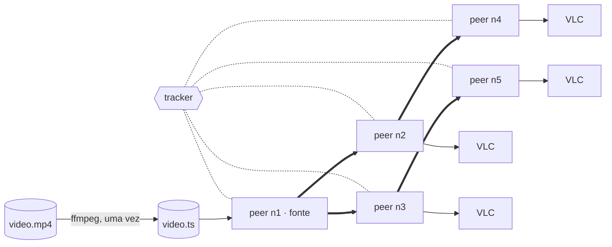

- **Linha grossa**: segmentos de vídeo, de pai para filho (plano de dados).
- **Linha tracejada**: conexão de controle de cada peer com o tracker.
- **Linha fina**: o vídeo que cada peer entrega ao seu VLC.

A ideia central: a fonte envia o vídeo só para os seus 2 filhos, e cada peer
repassa o que recebe para os seus próprios filhos. O tracker não toca no vídeo;
ele só decide quem é pai de quem e conserta a árvore quando alguém sai.

## 2. Componentes

| Componente | Papel | Onde está | Situação |
|---|---|---|---|
| **tracker** | Monta a árvore, avisa cada peer do pai e dos filhos, detecta saídas e quedas, religa os órfãos e muda de lugar quem não alcança o pai. | `cmd/tracker`, `tracker/` | pronto |
| **protocolo de controle** | Mensagens JSON entre peer e tracker. | `protocol/protocol.go` | pronto |
| **peer** | O cliente. No modo fonte, lê o vídeo do disco; no modo espectador, recebe do pai. Nos dois modos repassa aos filhos. | `cmd/peer`, `peer/` (proposta) | a fazer |
| **protocolo de dados** | Como um filho pede e recebe segmentos do pai. | `protocol/data.go` (proposta) | proposta |
| **VLC** | Toca o vídeo que o peer escreve na entrada padrão dele. | programa externo | a testar |
| **ffmpeg** | Converte o `.mp4` em `.ts` antes da transmissão. | programa externo | testado |
| **peer-sim** | Peer falso, sem vídeo, para testar o tracker: faz a parte de controle, abre a porta e testa se alcança o pai. | `cmd/peer-sim` | pronto |

Fonte e espectador são **o mesmo programa** com modos diferentes. A única
diferença é de onde vêm os segmentos (arquivo ou pai). Buffer, repasse aos
filhos, gravação e VLC são o mesmo código nos dois casos.

## 3. Atores e casos de uso

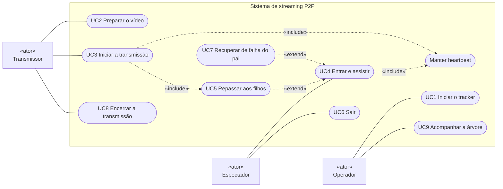

- **Operador**: quem sobe o tracker e acompanha a árvore pelo log.
- **Transmissor**: quem tem o vídeo e roda o peer no modo fonte.
- **Espectador**: quem roda o peer para assistir.

`«include»` é um passo que sempre acontece dentro do caso de uso (todo peer
manda heartbeat). `«extend»` é um desvio que só acontece em certas condições
(o espectador só repassa se ganhar filhos, e só se recupera se o pai cair).

### UC2 Preparar o vídeo

**Ator:** Transmissor. **Resultado:** um `video.ts` pronto para transmitir.

1. O transmissor converte o arquivo, sem recodificar:
   ```bash
   ffmpeg -i video.mp4 -c copy -f mpegts video.ts
   ```
2. Se o vídeo tiver keyframes muito espaçados, recodifica com um keyframe a
   cada 60 quadros (2 s a 30 fps), porque quem entra no meio só vê imagem a
   partir do próximo keyframe:
   ```bash
   ffmpeg -i video.mp4 -c:v libx264 -g 60 -c:a aac -f mpegts video.ts
   ```

Por que TS e não o próprio mp4 está na seção 7.

### UC3 Iniciar a transmissão

**Ator:** Transmissor. **Pré-condição:** tracker no ar e `video.ts` pronto.

1. O transmissor roda `peer -role source -video video.ts`.
2. O peer abre o listener na sua porta e manda `join` como `source`.
3. O tracker responde `welcome` sem pai: o peer é a raiz.
4. O peer começa a ler o `.ts` no ritmo do vídeo, numerando os segmentos e
   guardando-os no buffer, mesmo sem filhos ainda. É uma transmissão ao vivo:
   quem entrar depois pega dali em diante.
5. A cada filho que se conecta, inclui UC5.

**Fluxo alternativo:** 3a. Já existe uma fonte: o tracker responde `error` e o
peer encerra.

### UC4 Entrar e assistir

**Ator:** Espectador. **Pré-condição:** tracker e fonte no ar.

1. O espectador roda `peer -role peer`.
2. O peer abre o listener e manda `join` como `peer`.
3. O tracker responde `welcome` com o endereço do pai.
4. O peer conecta no pai e manda `hello` pedindo o vídeo ao vivo.
5. A cada segmento recebido, o peer grava no disco, escreve no VLC e repassa
   aos filhos, se houver.
6. Durante todo o tempo, manda `ping` ao tracker a cada 5 s.

**Fluxos alternativos:**

- 3a. Ainda não há fonte: o tracker responde `error`; o peer espera 5 s e volta ao passo 2.
- 4a. O pai não atende: o peer tenta de novo a cada 1 s, sempre no último pai
  que o tracker indicou. A cada 3 falhas seguidas, estende com UC7 (fluxo 1a).
- 5a. O tracker manda `child_added`: estende com UC5.
- 5b. A conexão com o pai cai ou chega `parent_changed`: estende com UC7.
- 5c. Chega `stream_ended`: o peer termina como em UC8.

### UC5 Repassar aos filhos

**Gatilho:** um filho se conecta ao listener do peer.

1. O tracker avisa o peer com `child_added`.
2. O filho conecta e manda `hello` com o `from_seq` que quer.
3. O peer envia, a partir de `from_seq`, o que tiver no buffer e depois segue
   repassando ao vivo cada segmento novo.
4. Quando chega `child_removed` ou a conexão cai, o peer para de enviar.

**Fluxo alternativo:** 3a. O filho é mais lento que o vídeo e a fila dele
enche: o peer descarta segmentos **só daquele filho** (ele vê um salto na
imagem) para não atrasar os outros.

### UC6 Sair

**Ator:** Espectador.

1. O espectador aperta Ctrl+C.
2. O peer fecha as conexões com os filhos, manda `leave` ao tracker e fecha o
   VLC e o arquivo gravado.
3. Os filhos dele passam por UC7.

### UC7 Recuperar de falha do pai

**Gatilho:** o pai sai, cai, trava ou não atende.

1. O tracker percebe a saída: por `leave`, pela conexão fechada (EOF/RST) ou por
   15 s sem `ping`.
2. O tracker tira o pai da árvore e religa os órfãos: `child_removed` para o
   avô, `parent_changed` para cada órfão e `child_added` para o novo pai de cada um.
3. O órfão conecta no novo pai com `hello` e `from_seq` = último segmento
   recebido + 1.
4. O novo pai envia do buffer a partir dali. Se o reparo levar menos tempo do
   que o buffer guarda (30 s), o vídeo continua **sem buraco**, só com uma pausa.

**Fluxos alternativos:**

- 1a. O pai está vivo para o tracker (manda `ping`), mas o peer não consegue se
  conectar a ele, por exemplo porque o firewall da máquina do pai bloqueia a
  porta. Só o filho percebe isso: depois de 3 falhas ele manda
  `parent_unreachable` ao tracker, que o muda de lugar sem tirar o pai da
  árvore: `child_removed` ao pai, `parent_changed` ao filho e `child_added` ao
  novo pai. Segue no passo 3. Detalhes na seção 9.5.
- 4a. O segmento pedido já saiu do buffer do novo pai: ele começa do mais
  antigo que tem, e o espectador vê um salto.
- 4b. O novo pai ainda não tem o segmento pedido (ele próprio está atrasado):
  envia quando chegar.

### UC8 Encerrar a transmissão

**Ator:** Transmissor.

1. O vídeo chega ao fim, ou o transmissor aperta Ctrl+C.
2. A fonte envia o último segmento e fecha as conexões de dados com os filhos.
   Cada filho repassa o que falta e fecha as conexões com os seus filhos: o fim
   desce pela árvore.
3. A fonte manda `leave`; o tracker manda `stream_ended` a todos e esvazia a
   árvore.
4. Cada peer, ao ter **as duas coisas** (fim da conexão com o pai e
   `stream_ended`), fecha o VLC e o arquivo e termina.

**Fluxo alternativo:** 1a. A fonte cai: as conexões dela caem e o tracker
detecta como em UC7, mas, por ser a raiz, manda `stream_ended` a todos.

### UC1 e UC9: tracker

O operador roda `tracker` (UC1) e acompanha a árvore no log, que é redesenhado a
cada entrada e saída (UC9). Detalhes em [02-arquitetura-do-tracker.md](02-arquitetura-do-tracker.md).

## 4. Implantação: onde cada coisa roda

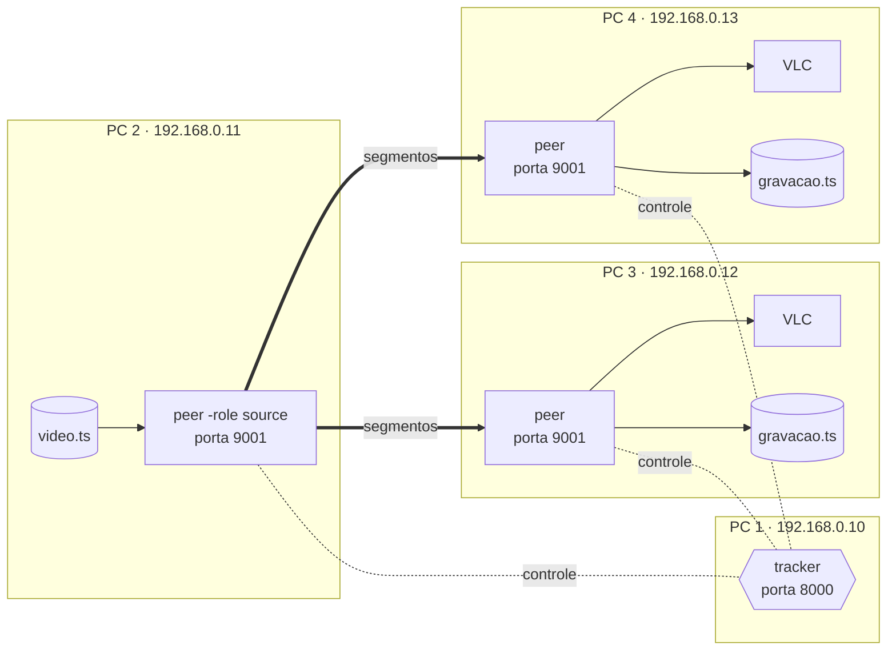

| Conexão | Quem abre | Destino | Formato |
|---|---|---|---|
| Controle | cada peer | tracker, porta 8000 | JSON, uma mensagem por linha |
| Dados | o filho | pai, na `listen_port` dele | um `hello` em JSON, depois frames binários |

Em máquinas diferentes, todos os peers podem usar a mesma porta. Na mesma
máquina (para testes), cada peer precisa de uma porta diferente.

## 5. O tracker por dentro

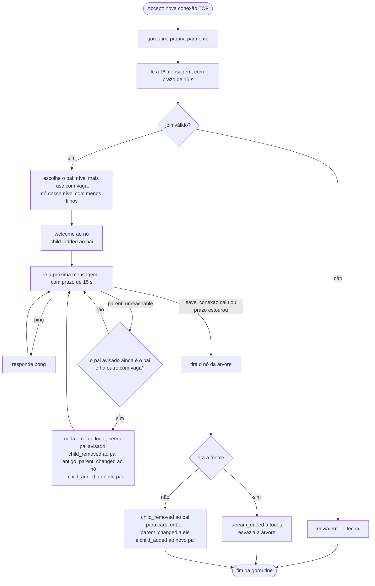

Esta parte está implementada em [`tracker/server.go`](../tracker/server.go) e
[`tracker/tree.go`](../tracker/tree.go), com os detalhes em
[02-arquitetura-do-tracker.md](02-arquitetura-do-tracker.md).

## 6. O peer por dentro

### Componentes

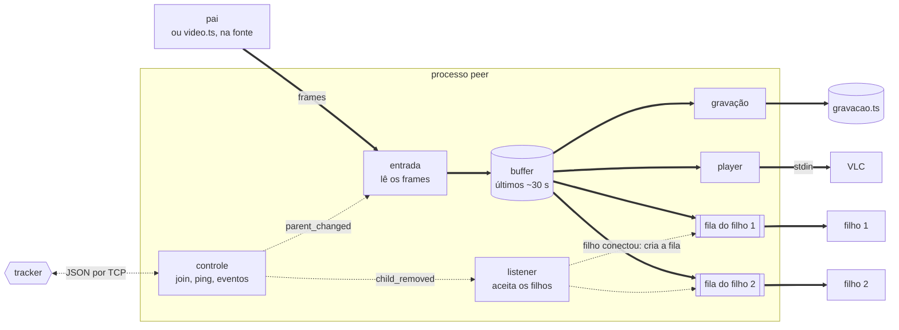

Os filhos se conectam ao **listener** (mandando o `hello`), que cria uma fila
para cada um.

- **Controle**: é o que o `peer-sim` já faz. Recebe os avisos do tracker e os
  repassa às outras partes.
- **Entrada**: na fonte, lê o `.ts` no ritmo do vídeo (seção 7); no espectador,
  lê os frames da conexão com o pai.
- **Buffer**: guarda os últimos ~30 s de segmentos, numerados. É dele que sai o
  vídeo para um filho novo ou religado.
- **Uma fila e uma goroutine por filho**: o mesmo padrão do `writeLoop` do
  tracker. Um filho lento não atrasa os outros nem o VLC.
- **Gravação e player**: escrevem os mesmos bytes no arquivo e na entrada padrão
  do VLC (`io.MultiWriter`).

### Estados

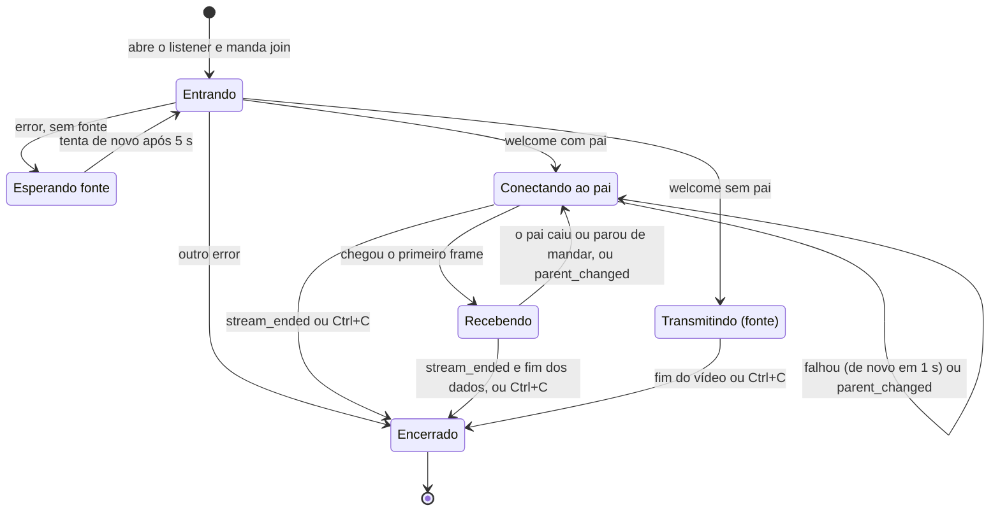

Ter filhos não é um estado à parte: em "Recebendo" ou "Transmitindo", um
`child_added` ou `child_removed` só muda a lista de filhos.

**Conectando ao pai** dura até chegar o primeiro frame. Uma tentativa falha
quando a conexão é recusada, quando o `Dial` não completa em 2 s ou quando
nenhum frame chega em 5 s depois do `hello`. O último caso é o do pai travado:
o sistema operacional dele aceita a conexão mesmo com o processo parado, então
só a falta de dados denuncia o problema.

O peer insiste **sempre no último pai que o tracker indicou** e nunca escolhe
um pai por conta própria, porque só o tracker conhece a árvore. Se o pai
morreu, a conexão de controle dele cai junto e o `parent_changed` costuma
chegar antes da segunda tentativa. Se o pai está vivo para o tracker mas o
filho não o alcança, a cada 3 falhas seguidas o filho manda
`parent_unreachable` e o tracker o muda de lugar (seção 9.5). Se a máquina do
pai sumiu da rede, o tracker só percebe depois de 15 s sem `ping`, mas as 3
falhas do filho somam cerca de 8 s (3 prazos de 2 s e 2 esperas de 1 s), então
o próprio aviso adianta o reparo desse filho.

### Ciclo de vida

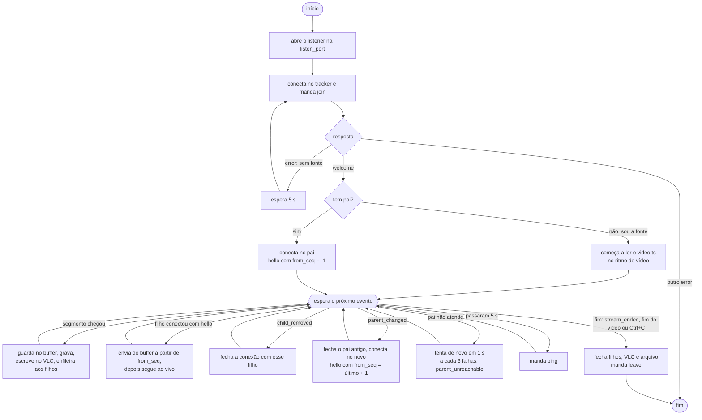

## 7. A fonte: formato e ritmo

### Por que MPEG-TS

Um espectador que entra atrasado recebe o vídeo **do meio** em diante. Isso
foi testado com o ffmpeg, cortando um pedaço do meio de um vídeo de 20 s:

| Formato | Pedaço do meio | Por quê |
|---|---|---|
| mp4 comum | não abre: "moov atom not found" | O índice do arquivo (`moov`) fica no fim (no teste, no byte 313633 de 336694). Sem ele o player não sabe ler os dados. |
| MPEG-TS | toca: 121 quadros decodificados; os 59 anteriores (cerca de 2 s) se perdem | O TS foi feito para TV digital: pacotes de 188 bytes que se sincronizam sozinhos. A imagem volta no primeiro keyframe. |

Por isso a fonte guarda o `.mp4` mas transmite em TS (UC2), e o intervalo entre
keyframes define quanto tempo quem entra no meio espera pela imagem.

### Envio no ritmo do vídeo

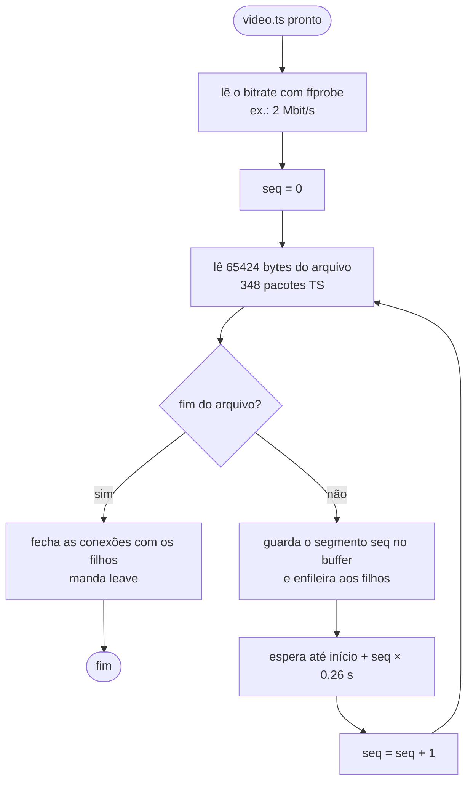

- O bitrate vem de `ffprobe -v error -show_entries format=bit_rate -of default=nw=1:nk=1 video.ts`.
- O tamanho do segmento é múltiplo de 188 para não cortar pacotes TS: 348 × 188 = 65424 bytes.
- Intervalo entre segmentos = tamanho × 8 ÷ bitrate. A 2 Mbit/s, 65424 × 8 ÷ 2 000 000 ≈ 0,26 s.
- A espera é calculada a partir do horário de início (`início + seq × intervalo`),
  e não somando esperas, para o atraso de cada volta não se acumular.
- **Só a fonte controla o ritmo.** Os outros peers repassam cada segmento assim
  que recebem.

Sem esse controle de ritmo, a fonte mandaria o arquivo inteiro de uma vez: seria
distribuição de arquivo, como no BitTorrent, e não streaming ao vivo.

## 8. Protocolo de dados entre peers (proposta)

### Conexão

O **filho conecta no pai**, no endereço que veio no `welcome` ou no
`parent_changed` (se não conseguir, segue a regra da seção 6, em "Estados"). A
primeira coisa que ele manda é uma linha JSON:

```json
{"type":"hello","id":"n4","from_seq":58}
```

| Campo | Significado |
|---|---|
| `id` | O ID que o tracker deu ao filho. |
| `from_seq` | O primeiro segmento que o filho quer. `-1` significa "ao vivo": começar do mais recente. |

O pai **aceita qualquer `hello`**, sem conferir se já recebeu o `child_added`.
O tracker manda o `welcome` ao filho e o `child_added` ao pai ao mesmo tempo, e
o filho pode conectar antes de o pai ler o aviso. Quem controla quantos filhos
cada nó tem é o tracker; o `child_added` serve ao pai como registro.

### Frames

Depois do `hello`, o pai envia só frames binários:

```
 0                 4                 8
 +-----------------+-----------------+--------------------------+
 | seq (uint32 BE) | len (uint32 BE) | dados: len bytes de TS   |
 +-----------------+-----------------+--------------------------+
```

JSON não serve para o vídeo: os bytes teriam que ir em base64, que ocupa 33% a
mais. Em Go, o cabeçalho se escreve com `binary.BigEndian.PutUint32` e se lê
com `io.ReadFull` seguido de `binary.BigEndian.Uint32`.

### Buffer

Cada peer guarda os últimos ~30 s. A 2 Mbit/s isso dá cerca de 7,5 MB, ou ~120
segmentos de 64 KB. O tamanho cobre com folga o pior caso de reparo (15 s de
timeout de heartbeat), então um órfão religado retoma de onde parou, sem
perder vídeo.

### Decisões do plano de dados

| Decisão | Escolha | Por quê |
|---|---|---|
| Quem abre a conexão | o filho | Ele recebe o endereço do pai no `welcome`. Também ajuda com NAT: uma folha não precisa aceitar conexões. |
| Formato do vídeo | MPEG-TS | Pode ser tocado a partir do meio (seção 7). |
| Unidade | segmento de 65424 bytes numerado | Tamanho fixo é simples; o número permite retomar após troca de pai. |
| Ritmo | só a fonte controla | Os outros repassam na hora; o atraso por salto fica pequeno. |
| Enquadramento | cabeçalho binário de 8 bytes | Sem o custo do base64. |
| Filho lento | descarta segmentos só daquele filho | Ao vivo, chegar atrasado vale menos do que chegar. Os outros não são afetados. |
| Reprodução | VLC lendo da entrada padrão (`vlc -`) | Toca enquanto chega, sem esperar o arquivo inteiro. |
| Gravação | os mesmos bytes num `.ts` local | O arquivo gravado também abre no VLC depois. |

## 9. Cenários de ponta a ponta

### 9.1 Início da transmissão e entrada de um espectador

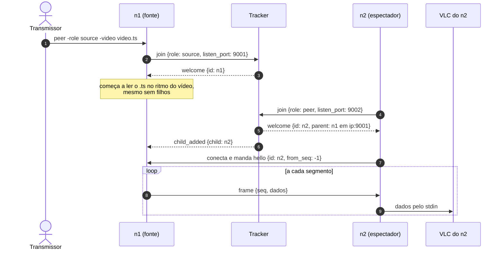

**Por que o tracker não pergunta ao pai antes do `welcome`.** Pode parecer
mais seguro o tracker confirmar que o n1 está vivo antes de indicá-lo ao n2.
Mas a confirmação só prova que o pai estava vivo **no momento da resposta**:
ele pode cair um milissegundo depois, antes de o filho conectar. A confirmação
diminuiria a janela do problema sem eliminá-la, e o filho continuaria
precisando do caminho de recuperação (UC7). Em troca, toda entrada esperaria
uma ida e volta a mais, e o tracker precisaria de um estado de "entrada
pendente" com prazo próprio, o que abre corridas novas (o pai morrer enquanto
outra entrada espera a resposta dele). O tracker já tem uma prova recente de
que o pai está vivo: o último `ping`, de no máximo 15 s atrás.

É um princípio geral de sistemas distribuídos: a informação sobre um nó remoto
sempre chega velha, então o sistema tem que funcionar com ela velha, em vez de
tentar torná-la fresca. Aqui isso vale porque o filho já está registrado como
filho do n1 quando recebe o `welcome`. Se o n1 tiver morrido, o tracker o tira
da árvore e o n2, órfão, recebe `parent_changed`. O `welcome` e o
`parent_changed` vão pela mesma conexão TCP e pela mesma fila, então chegam
nessa ordem.

O que o filho vê ao tentar conectar num pai com problema (medido no Windows,
na mesma máquina):

| Situação do pai | O que acontece no `Dial` do filho | Quando chega o `parent_changed` |
|---|---|---|
| Processo fechado ou morto | recusado na hora ("actively refused") | quase na hora: a conexão de controle do pai cai junto |
| Processo travado | conecta em 1 ms e o `hello` é enviado sem erro; nenhum frame chega | até 15 s (o pai para de mandar `ping`) |
| Máquina desligada ou fora da rede | espera até o prazo do `Dial` (sem prazo, cerca de 20 s no Windows) | até 15 s, ou antes se o filho avisar (seção 9.5) |
| Processo vivo, porta bloqueada por firewall | recusado ou sem resposta, para sempre | nunca, porque para o tracker o pai está bem; por isso existe o `parent_unreachable` (seção 9.5) |

### 9.2 Transmissão em regime

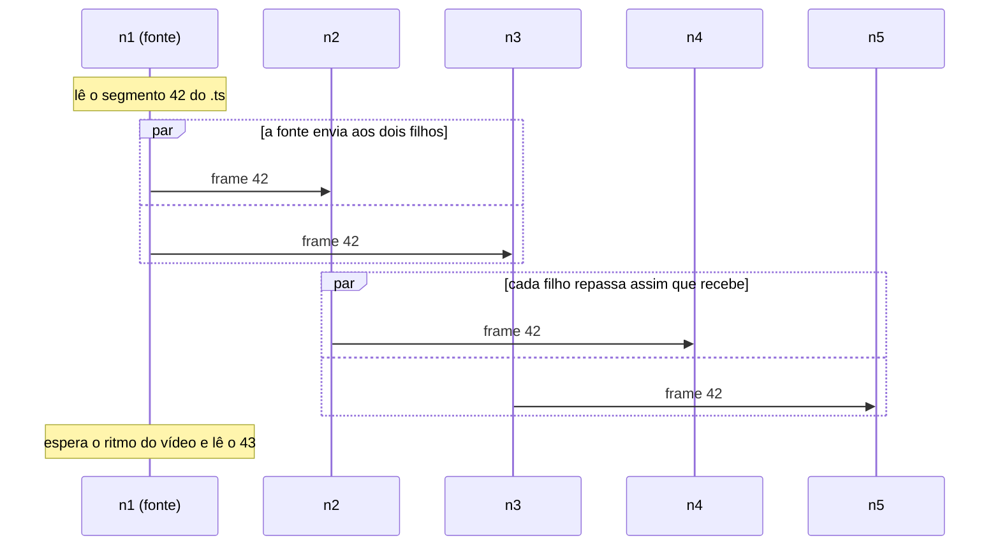

Numa rede local, cada salto acrescenta poucos milissegundos (o tempo de
receber um segmento de 64 KB). A maior parte do atraso que o espectador percebe
vem do buffer do próprio VLC e da espera pelo primeiro keyframe.

### 9.3 Queda de um nó e recuperação

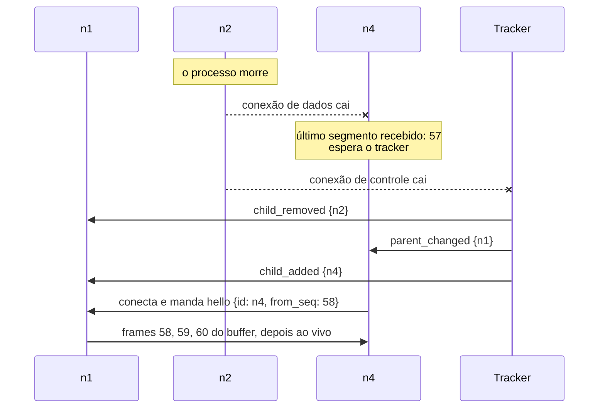

Se o n2 tinha outros filhos, cada um recebe o seu `parent_changed` e faz o
mesmo com o pai novo. Os netos não percebem nada além de uma pausa: continuam
ligados aos mesmos pais.

### 9.4 Fim da transmissão

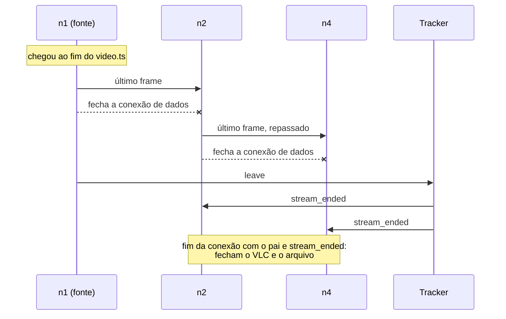

O peer espera **as duas coisas** porque elas viajam por caminhos diferentes. O
`stream_ended` vem direto do tracker e pode chegar antes dos últimos segmentos,
que ainda estão descendo pela árvore. Se o peer fechasse no `stream_ended`,
perderia o final do vídeo.

### 9.5 Pai vivo, mas inalcançável

O heartbeat mostra que o pai está vivo **para o tracker**, não que os filhos
conseguem chegar até ele. O caso mais provável num laboratório é o Firewall do
Windows: na primeira vez que o peer abre a porta, o Windows pergunta se libera;
se alguém clicar em "Cancelar", o peer continua mandando `ping` normalmente
(a conexão com o tracker é de saída), mas ninguém consegue se conectar a ele.
Só o filho percebe o problema, e só o tracker pode escolher outro pai, então o
filho avisa:

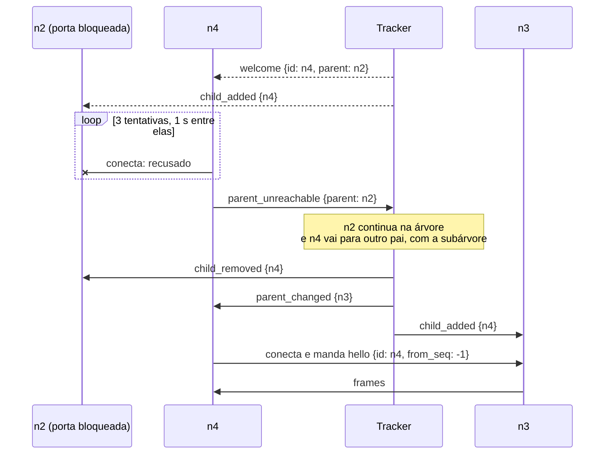

Regras do tracker (`Tree.Relocate` em [`tracker/tree.go`](../tracker/tree.go)):

- **O pai não sai da árvore.** Para o tracker ele está vivo, e o problema pode
  estar só no caminho entre os dois. Quem muda é o filho, com a subárvore dele.
- **O novo pai sai da mesma BFS da entrada**, pulando o pai avisado. O filho é
  desligado da árvore antes da busca, então nem ele nem os seus descendentes
  viram candidatos, e não há risco de ciclo.
- **O tracker lembra do aviso.** Num reparo futuro (por exemplo, se o novo pai
  cair), o filho não volta para debaixo de um pai que ele já avisou não
  alcançar, a não ser que não haja nenhuma outra vaga: um pai problemático
  ainda é melhor que ficar fora da árvore.
- **Aviso atrasado é ignorado.** O aviso traz o pai a que se refere. Se o filho
  já recebeu outro pai (um `parent_changed` cruzou com o aviso), o pai citado
  não é mais o atual e nada muda.
- **Sem outra vaga, o filho fica onde está.** Ele continua tentando e avisa de
  novo mais tarde; quando entrar mais gente, o aviso seguinte o muda de lugar.
  Se a porta bloqueada for a da fonte, nada resolve: todos os filhos dela ficam
  sem vídeo até alguém liberar a porta.

O roteiro [`scripts/demo-firewall.ps1`](../scripts/demo-firewall.ps1) sobe o n2
com `-firewall` (ele manda `ping`, mas não abre a porta) e depois coloca o n4,
o n5 e o n6, um a cada 3 s. Log do tracker (horários removidos):

```
[n4] entrou como peer em 127.0.0.1:9004
árvore com 4 nó(s):
n1 127.0.0.1:9001
├── n2 127.0.0.1:9002
│   └── n4 127.0.0.1:9004
└── n3 127.0.0.1:9003
[n4] não alcança o pai n2; mudou para n3
árvore com 4 nó(s):
n1 127.0.0.1:9001
├── n2 127.0.0.1:9002
└── n3 127.0.0.1:9003
    └── n4 127.0.0.1:9004
...
[n6] não alcança o pai n2; mudou para n4
árvore com 6 nó(s):
n1 127.0.0.1:9001
├── n2 127.0.0.1:9002
└── n3 127.0.0.1:9003
    ├── n4 127.0.0.1:9004
    │   └── n6 127.0.0.1:9006
    └── n5 127.0.0.1:9005
```

A demo também mostra a limitação deste tratamento: como o n2 continua com
vagas, **cada nó novo** cai primeiro debaixo dele e só sai depois das 3
tentativas: cerca de 2 s sem vídeo quando a conexão é recusada, como na demo,
e até 8 s quando o firewall descarta os pacotes sem responder. Uma melhoria
seria o tracker parar de dar filhos a um nó que dois filhos diferentes não
alcançaram: com um aviso só, o problema pode estar no filho; com dois, quase
certamente está no pai.

## 10. Estrutura de código proposta para o cliente

```
protocol/
  protocol.go     mensagens de controle (pronto)
  data.go         hello e frame binário
peer/
  control.go      conexão com o tracker (a partir do peer-sim)
  source.go       lê o .ts no ritmo do vídeo (só na fonte)
  upstream.go     conecta no pai e lê os frames
  buffer.go       guarda os últimos segmentos e entrega a partir de um seq
  children.go     listener, uma fila e uma goroutine por filho
  player.go       abre o VLC e escreve na entrada padrão dele
cmd/peer/
  main.go         opções: -tracker, -role, -port, -video, -save, -no-vlc
```

O formato do frame fica em `protocol/`, junto com as mensagens de controle,
porque é o contrato entre peers. A opção `-no-vlc` permite testar vários peers
na mesma máquina sem abrir uma janela do VLC para cada um.

## 11. O que está pronto e o que falta

| Parte | Situação |
|---|---|
| Tracker: árvore, entrada, saída, heartbeat, reparo | pronto, com testes automatizados e demonstração |
| Tracker: pai inalcançável (`parent_unreachable`) | pronto, com testes automatizados e demonstração (`scripts/demo-firewall.ps1`) |
| Protocolo de controle | pronto |
| `peer-sim` | pronto (ferramenta de teste); abre a porta, testa o pai e manda `parent_unreachable` |
| Preparação do vídeo (ffmpeg → TS) | comandos definidos e testados |
| Protocolo de dados (`hello` e frames) | proposta deste documento; falta combinar |
| Cliente `peer`: controle | pode partir do `peer-sim` |
| Cliente `peer`: fonte, buffer, repasse, gravação | a fazer |
| Reprodução no VLC pela entrada padrão | a fazer e testar |
